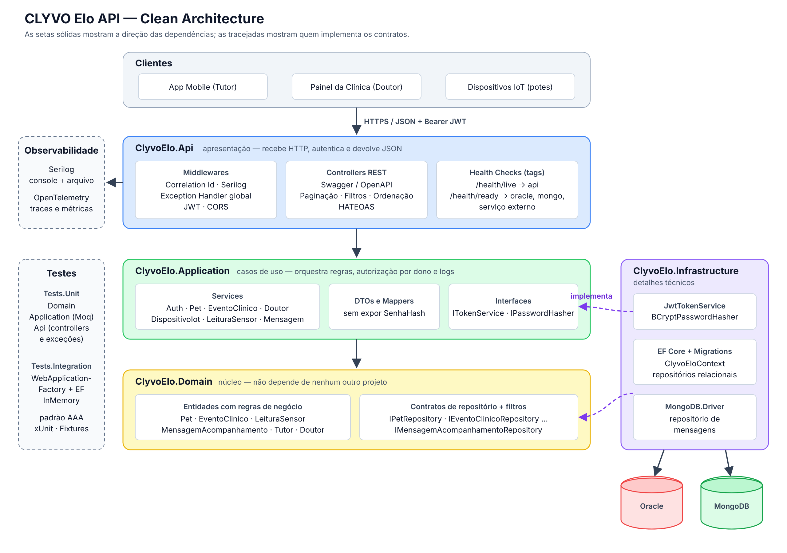

# CLYVO Elo — API (.NET)

API em ASP.NET Core do **CLYVO Elo**, solução construída para o Challenge FIAP 2026 (CLYVO VET). Ela liga a clínica veterinária ao tutor depois da consulta: os doutores registram eventos clínicos (vacinas, exames, pós-operatório) e mandam mensagens de acompanhamento direto para o tutor do pet. Já o tutor acompanha tudo pelo app e recebe as leituras dos sensores IoT instalados nos potes de água e ração.

Esta é a entrega final da disciplina **Advanced Business Development with .NET (Sprint 4)**. Ela junta tudo o que foi feito nas Sprints 1, 2 e 3 numa solução em Clean Architecture, com:

- API RESTful completa, com paginação, filtros, ordenação e HATEOAS
- persistência relacional (Oracle + EF Core com migrações) e NoSQL (MongoDB)
- autenticação e autorização com JWT
- tratamento global de exceções no padrão ProblemDetails
- health checks segregados por tags, logging estruturado e OpenTelemetry
- testes unitários e de integração em xUnit

## Integrantes

| Nome | RM | Turma |
|---|---|---|
| Gabriel Cabral Mendes Mariano | RM563230 | 2TDSPO |
| João Victor Santana dos Santos | RM566063 | 2TDSPX |

## Links

- Deploy (Render): https://clyvoelo-dotnet.onrender.com/swagger/index.html
- Repositório: https://github.com/GabrielCabralmm/ClyvoElo-dotnet

## Stack

- .NET 10 / ASP.NET Core Web API
- Entity Framework Core 10 + Oracle.EntityFrameworkCore (com migrações)
- MongoDB.Driver (mensagens de acompanhamento)
- JWT Bearer com dois papéis (Tutor e Doutor) e senhas com hash BCrypt
- Swagger / OpenAPI (Swashbuckle + Annotations)
- Serilog (console + arquivo) e OpenTelemetry (tracing e métricas)
- Microsoft.Extensions.Diagnostics.HealthChecks
- xUnit, Moq, WebApplicationFactory e EF Core InMemory

## Arquitetura



A solução segue a Clean Architecture. As dependências sempre apontam para dentro, em direção ao domínio:

```
ClyvoElo.Api  ──►  ClyvoElo.Application  ──►  ClyvoElo.Domain
      │                    ▲                         ▲
      └──► ClyvoElo.Infrastructure ──────────────────┘
           (implementa as interfaces da Application e os repositórios do Domain)
```

| Projeto | Responsabilidade |
|---|---|
| `ClyvoElo.Domain` | Entidades com as regras de negócio (`Pet.AtualizarPeso`, `EventoClinico.Criar`, `MensagemAcompanhamento.MarcarComoLida`...), exceção de domínio, filtros de consulta, `ResultadoPaginado<T>` e os contratos de repositório. Não depende de nenhum outro projeto nem de pacote externo. |
| `ClyvoElo.Application` | Casos de uso (services), DTOs de entrada e saída, mapeamento e regras de autorização por dono do recurso (um tutor só altera os próprios pets, um doutor só remove as mensagens que ele enviou). Define as interfaces `ITokenService` e `IPasswordHasher`. |
| `ClyvoElo.Infrastructure` | Detalhes técnicos: `ClyvoEloContext`, mapeamentos com `IEntityTypeConfiguration`, migrações, repositórios concretos do EF Core e do MongoDB, geração de JWT, BCrypt e health checks do Oracle, do MongoDB e do serviço externo. |
| `ClyvoElo.Api` | Controllers, HATEOAS, middlewares (correlation id e tratamento global de exceções), configuração de Swagger, autenticação, observabilidade e health checks. |

### SOLID e Clean Code no projeto

- **S**: cada service cuida de um agregado (`PetService`, `EventoClinicoService`...), e os controllers só traduzem HTTP para o service. Regras de negócio ficam nas entidades.
- **O**: novos filtros e ordenações entram no repositório sem mudar o contrato. Os health checks são adicionados por registro, sem alterar os outros.
- **L / I**: interfaces pequenas e específicas por repositório (`IPetRepository`, `IMensagemAcompanhamentoRepository`), e não um repositório genérico "faz-tudo".
- **D**: Application e Domain dependem só de abstrações. A Infrastructure é ligada no `Program.cs` por `AddApplication()` e `AddInfrastructure()`.
- Os controllers não têm `try/catch`: exceções de negócio sobem e o `GlobalExceptionHandler` converte cada tipo no status HTTP certo.

### Estrutura de pastas

```
ClyvoElo.Domain/
  Entities/  Constantes/  Common/  Filtros/  Exceptions/  Repositories/
ClyvoElo.Application/
  DTOs/  Services/  Mappers/  Interfaces/  Exceptions/  Common/  Observabilidade/
ClyvoElo.Infrastructure/
  Persistence/ (Context, Configurations, Migrations, DadosIniciais)
  Repositories/  Mongo/  Security/  HealthChecks/
ClyvoElo.Api/
  Controllers/  Hateoas/  Middlewares/  Extensions/  HealthChecks/
ClyvoElo.Tests.Unit/
  Domain/  Application/  Api/  Fixtures/
ClyvoElo.Tests.Integration/
  Endpoints/  Fixtures/  Fakes/
docs/
  arquitetura.png  arquitetura.svg  swagger.json  migracao-inicial.sql
```

## Persistência

### Oracle (relacional) com EF Core

As tabelas `TUTOR`, `PET`, `CLINICA`, `DOUTOR`, `EVENTO_CLINICO`, `DISPOSITIVO_IOT` e `LEITURA_SENSOR` são mapeadas em `ClyvoElo.Infrastructure/Persistence/Configurations`. A migração inicial (`20261029160111_CriacaoInicial`) fica em `Persistence/Migrations`. O SQL que ela gera para o Oracle foi exportado em [`docs/migracao-inicial.sql`](docs/migracao-inicial.sql).

Para instalar a ferramenta do EF (uma vez só):

```
dotnet tool install --global dotnet-ef
```

Para aplicar as migrações num schema Oracle vazio:

```
dotnet ef database update --project ClyvoElo.Infrastructure --startup-project ClyvoElo.Api
```

Outra opção é ligar `"Database:AplicarMigracoesAoIniciar": true` no `appsettings.json`. Assim a API roda `Migrate()` ao subir e, se o banco estiver vazio, cria uma massa de dados de demonstração (`DadosIniciais`).

Se o schema já foi criado pelo script da disciplina de Banco de Dados (`2TDSPO_2TDSPX_2026_CodigoSql_Gabriel_Joao.sql`), as tabelas já existem. Nesse caso, basta registrar a migração inicial como aplicada:

```sql
CREATE TABLE "__EFMigrationsHistory" (
  "MigrationId" NVARCHAR2(150) NOT NULL,
  "ProductVersion" NVARCHAR2(32) NOT NULL,
  CONSTRAINT "PK___EFMigrationsHistory" PRIMARY KEY ("MigrationId")
);
INSERT INTO "__EFMigrationsHistory" VALUES ('20261029160111_CriacaoInicial', '10.0.12');
COMMIT;
```

### MongoDB (NoSQL)

As **mensagens de acompanhamento** que o doutor envia ao tutor (orientações de pós-operatório, medicação, retorno) ficam na coleção `mensagens_acompanhamento`. O conteúdo é livre, o volume é alto e não há relacionamento forte, então elas se encaixam bem em documentos. Exemplo de documento:

```json
{
  "_id": ObjectId("6650f1c2a1b2c3d4e5f60718"),
  "idPet": 1, "nomePet": "Toby", "idTutor": 1,
  "idDoutor": 1, "nomeDoutor": "Dra. Ana Ferreira",
  "categoria": "POS_OPERATORIO",
  "assunto": "Cuidados com os pontos",
  "conteudo": "Manter o colar elizabetano por 10 dias.",
  "dataEnvio": ISODate("2026-10-29T13:00:00Z"),
  "lida": false, "dataLeitura": null
}
```

Para subir um MongoDB local com Docker:

```
docker run -d --name clyvo-mongo -p 27017:27017 mongo:7
```

### Padrão Repository

Os contratos ficam no Domain (`ClyvoElo.Domain/Repositories`). As implementações concretas ficam na Infrastructure:

| Contrato | Implementação | Banco |
|---|---|---|
| `ITutorRepository` | `TutorRepository` | Oracle |
| `IDoutorRepository` | `DoutorRepository` | Oracle |
| `IPetRepository` | `PetRepository` | Oracle |
| `IEventoClinicoRepository` | `EventoClinicoRepository` | Oracle |
| `IDispositivoIotRepository` | `DispositivoIotRepository` | Oracle |
| `ILeituraSensorRepository` | `LeituraSensorRepository` | Oracle |
| `IMensagemAcompanhamentoRepository` | `MensagemAcompanhamentoRepository` | MongoDB |

## Instalação e execução

1. Clone o repositório e preencha `ClyvoElo.Api/appsettings.json` (ou use variáveis de ambiente, como `ConnectionStrings__OracleDb` e `MongoDb__ConnectionString`):

```json
{
  "ConnectionStrings": {
    "OracleDb": "User Id=SEU_USUARIO;Password=SUA_SENHA;Data Source=SEU_HOST:1521/SEU_SERVICE;"
  },
  "MongoDb": {
    "ConnectionString": "mongodb://localhost:27017",
    "DatabaseName": "clyvo_elo",
    "ColecaoMensagens": "mensagens_acompanhamento"
  }
}
```

2. Prepare o banco Oracle com o script da disciplina de Banco ou com as migrações (veja acima).

3. Rode a API:

```
dotnet restore
dotnet run --project ClyvoElo.Api
```

O navegador abre em `/swagger`, onde todos os endpoints podem ser testados.

Com Docker:

```
docker build -t clyvoelo-api .
docker run -p 8080:8080 -e ConnectionStrings__OracleDb="..." -e MongoDb__ConnectionString="..." clyvoelo-api
```

## Autenticação e autorização

Todos os tutores e doutores da massa de dados usam a senha `clyvo123`:

- Tutor: `gabriel@email.com` em `POST /api/Auth/login/tutor`
- Doutor: `ana.ferreira@clyvovet.com` em `POST /api/Auth/login/doutor`

Cole o token devolvido no botão **Authorize** do Swagger.

| Ação | Quem pode |
|---|---|
| Consultas de pets, eventos, doutores, dispositivos e leituras | Livre |
| Cadastrar pet, atualizar peso, excluir pet | Tutor (só os próprios pets) |
| Registrar evento clínico, atualizar status, excluir evento | Doutor |
| Enviar e excluir mensagem de acompanhamento | Doutor (só as que ele enviou) |
| Ler mensagens e marcar como lida | Tutor (só as dos próprios pets); o doutor consulta todas |
| Registrar leitura de sensor | Livre (enviado pelo dispositivo IoT) |

## Endpoints

A documentação completa fica no Swagger (`/swagger`). Uma versão exportada está em [`docs/swagger.json`](docs/swagger.json).

| Método | Rota | Descrição | Acesso |
|---|---|---|---|
| POST | `/api/Auth/login/tutor` | Login do tutor | Livre |
| POST | `/api/Auth/login/doutor` | Login do doutor | Livre |
| POST | `/api/Auth/cadastro/tutor` | Cadastro de tutor (já devolve token) | Livre |
| GET | `/api/Pets` | Lista pets (paginado, com filtros) | Livre |
| GET | `/api/Pets/meus` | Pets do tutor logado | Tutor |
| GET | `/api/Pets/{id}` | Detalhe do pet | Livre |
| POST | `/api/Pets` | Cadastra pet | Tutor |
| PUT | `/api/Pets/{id}/peso` | Atualiza o peso (corpo: `12.5`) | Tutor dono |
| DELETE | `/api/Pets/{id}` | Remove o pet | Tutor dono |
| GET | `/api/EventosClinicos` | Lista eventos (paginado, com filtros) | Livre |
| GET | `/api/EventosClinicos/pet/{idPet}` | Eventos de um pet | Livre |
| GET | `/api/EventosClinicos/{id}` | Detalhe do evento | Livre |
| POST | `/api/EventosClinicos` | Registra evento | Doutor |
| PUT | `/api/EventosClinicos/{id}/status` | Atualiza status (corpo: `"CONCLUIDO"`) | Doutor |
| DELETE | `/api/EventosClinicos/{id}` | Remove evento | Doutor |
| GET | `/api/Doutores` | Lista doutores | Livre |
| GET | `/api/Doutores/{id}` | Detalhe do doutor | Livre |
| GET | `/api/DispositivosIot` | Lista dispositivos | Livre |
| GET | `/api/DispositivosIot/{id}` | Detalhe do dispositivo | Livre |
| GET | `/api/DispositivosIot/pet/{idPet}` | Dispositivos de um pet | Livre |
| GET | `/api/LeiturasSensor` | Lista leituras | Livre |
| GET | `/api/LeiturasSensor/{id}` | Detalhe da leitura | Livre |
| GET | `/api/LeiturasSensor/pet/{idPet}` | Leituras de um pet | Livre |
| GET | `/api/LeiturasSensor/dispositivo/{idDispositivo}` | Leituras de um dispositivo | Livre |
| POST | `/api/LeiturasSensor` | Registra leitura do IoT | Livre |
| GET | `/api/Mensagens` | Lista mensagens (MongoDB) | Tutor / Doutor |
| GET | `/api/Mensagens/{id}` | Detalhe da mensagem | Tutor / Doutor |
| POST | `/api/Mensagens` | Doutor envia mensagem ao tutor | Doutor |
| PATCH | `/api/Mensagens/{id}/lida` | Marca como lida | Tutor destinatário |
| DELETE | `/api/Mensagens/{id}` | Remove mensagem | Doutor autor |
| GET | `/health`, `/health/live`, `/health/ready` | Health checks | Livre |

### Paginação, filtros e ordenação

Todas as listagens aceitam os mesmos parâmetros de query:

| Parâmetro | Padrão | Descrição |
|---|---|---|
| `pagina` | 1 | Página desejada |
| `tamanhoPagina` | 10 | Itens por página (máximo 50) |
| `ordenarPor` | depende do recurso | Campo de ordenação |
| `direcao` | `asc` | `asc` ou `desc` |

| Recurso | Filtros | `ordenarPor` |
|---|---|---|
| Pets | `nome`, `especie`, `raca`, `idTutor` | `nome`, `especie`, `peso`, `dataNascimento` |
| Eventos clínicos | `idPet`, `idDoutor`, `tipoEvento`, `status`, `dataInicio`, `dataFim` | `data`, `tipo`, `status`, `id` |
| Doutores | `nome`, `idClinica` | `nome`, `crmv`, `id` |
| Dispositivos IoT | `idPet`, `tipoDispositivo` | `tipo`, `dataInstalacao`, `id` |
| Leituras | `idPet`, `idDispositivo`, `tipoMedida`, `dataInicio`, `dataFim` | `data`, `valor`, `tipo` |
| Mensagens | `idPet`, `idDoutor`, `categoria`, `lida` | `data`, `assunto`, `categoria` |

Exemplo: `GET /api/Pets?especie=cachorro&ordenarPor=nome&direcao=desc&pagina=1&tamanhoPagina=5`

### HATEOAS

Toda resposta de consulta traz `links` com as ações possíveis sobre o recurso. As listagens também trazem os links de navegação entre páginas (`self`, `first`, `prev`, `next`, `last`), e esses links mantêm os filtros usados:

```json
{
  "itens": [
    {
      "idPet": 1,
      "idTutor": 1,
      "nomeTutor": "Gabriel Mariano",
      "nome": "Toby",
      "especie": "CACHORRO",
      "raca": "Golden Retriever",
      "dataNascimento": "2020-03-14T00:00:00",
      "pesoKg": 31.5,
      "links": [
        { "href": "/api/Pets/1", "rel": "self", "metodo": "GET" },
        { "href": "/api/Pets/1/peso", "rel": "atualizar_peso", "metodo": "PUT" },
        { "href": "/api/Pets/1", "rel": "remover", "metodo": "DELETE" },
        { "href": "/api/EventosClinicos/pet/1", "rel": "eventos_clinicos", "metodo": "GET" },
        { "href": "/api/DispositivosIot/pet/1", "rel": "dispositivos_iot", "metodo": "GET" },
        { "href": "/api/LeiturasSensor/pet/1", "rel": "leituras_sensor", "metodo": "GET" },
        { "href": "/api/Mensagens?idPet=1", "rel": "mensagens", "metodo": "GET" }
      ]
    }
  ],
  "pagina": 1,
  "tamanhoPagina": 1,
  "totalItens": 3,
  "totalPaginas": 3,
  "links": [
    { "href": "/api/Pets?especie=cachorro&pagina=1", "rel": "self", "metodo": "GET" },
    { "href": "/api/Pets?especie=cachorro&pagina=2", "rel": "next", "metodo": "GET" },
    { "href": "/api/Pets?especie=cachorro&pagina=3", "rel": "last", "metodo": "GET" }
  ]
}
```

### Tratamento de erros

Os erros saem sempre no formato **ProblemDetails** (RFC 7807), com o `correlationId` da requisição:

```json
{
  "type": "https://tools.ietf.org/html/rfc9110#section-15.5.5",
  "title": "Recurso não encontrado",
  "status": 404,
  "detail": "Pet 99 não encontrado.",
  "instance": "/api/Pets/99",
  "correlationId": "4bf92f3577b34da6a3ce929d0e0e4736"
}
```

| Situação | Status |
|---|---|
| Dados inválidos no corpo (DataAnnotations) ou regra de negócio violada | 400 |
| Sem token ou credenciais erradas | 401 |
| Papel sem permissão ou recurso de outro usuário | 403 |
| Recurso não encontrado | 404 |
| Email já cadastrado ou registro com vínculos | 409 |
| Erro inesperado (a mensagem interna nunca é exposta) | 500 |

### Valores aceitos

- `tipoEvento`: `VACINA`, `CHECKUP`, `POS_OPERATORIO`, `MEDICACAO`, `EXAME`
- `status`: `PENDENTE`, `CONCLUIDO`, `ATRASADO`
- `categoria` (mensagens): `POS_OPERATORIO`, `MEDICACAO`, `ORIENTACAO`, `RETORNO`

A API normaliza esses valores para maiúsculo e recusa os inválidos com 400 antes de chegar ao banco.

## Monitoramento e observabilidade

### Health Checks

As verificações são segregadas por **tags**, e cada endpoint executa só o grupo dele:

| Endpoint | Tag | Verificações | Uso |
|---|---|---|---|
| `GET /health/live` | `live` | `api` | Liveness: o processo está de pé? Não consulta dependências, então responde rápido e não derruba o container se o banco cair. |
| `GET /health/ready` | `ready` | `oracle_db`, `mongodb`, `servico_externo` | Readiness: a API consegue atender? Testa a conexão real com o Oracle, o ping no MongoDB e a conectividade externa. |
| `GET /health` | todas | todas | Visão completa para diagnóstico. |

As tags `banco` (Oracle e MongoDB) e `externo` também ficam disponíveis para novos agrupamentos. A resposta retorna 200 quando está `Healthy` ou `Degraded` e 503 quando está `Unhealthy`:

```json
{
  "status": "Healthy",
  "duracaoTotalMs": 41.2,
  "checks": [
    { "nome": "oracle_db", "status": "Healthy", "descricao": "Conexão com o Oracle está OK.", "duracaoMs": 30.1, "tags": ["ready", "banco"], "erro": null },
    { "nome": "mongodb", "status": "Healthy", "descricao": "Conexão com o MongoDB está OK.", "duracaoMs": 8.4, "tags": ["ready", "banco"], "erro": null }
  ]
}
```

Para monitorar em produção, aponte o liveness probe para `/health/live` e o readiness probe para `/health/ready` (Kubernetes, Azure App Service Health Check, Render ou qualquer ferramenta de uptime).

### Logs estruturados (Serilog)

- Níveis `Information`, `Warning` e `Error`. Regras de negócio recusadas saem como `Warning` e erros inesperados como `Error`, com a stack trace.
- Toda requisição recebe um **`X-Correlation-Id`**. Se o cliente enviar o cabeçalho, ele é reaproveitado; senão, é usado o TraceId do OpenTelemetry. O id aparece em todos os logs da requisição, no cabeçalho da resposta e no corpo dos erros.
- Saída no console e em `ClyvoElo.Api/logs/clyvoelo-AAAAMMDD.log` (um arquivo por dia).

### Tracing e métricas (OpenTelemetry)

- Tracing automático das requisições HTTP de entrada e saída, mais o span manual `RegistrarEventoClinico`, com as tags do evento.
- Métricas automáticas do ASP.NET Core (tempo de resposta e requisições por status code) e de runtime (memória, GC, threads).
- Métricas de negócio próprias: `clyvoelo.eventos_clinicos.registrados`, `clyvoelo.auth.logins_recusados` e `clyvoelo.mensagens.enviadas`.
- Exportação no console, visível ao rodar `dotnet run`.

## Testes

```
dotnet test
```

Resultado atual: **100 testes passando** (75 unitários e 25 de integração).

Para gerar o relatório de cobertura:

```
dotnet test --collect:"XPlat Code Coverage"
```

Os dois projetos de teste rodam **sem precisar de Oracle nem de MongoDB**:

- **ClyvoElo.Tests.Unit**
  - `Domain/`: regras das entidades (peso do pet, tipo e status do evento, mensagem lida, leitura de sensor, paginação).
  - `Application/`: services com os repositórios mockados no Moq (autorização por dono, login, cadastro, conflitos, recurso não encontrado).
  - `Api/`: controller com HATEOAS e `GlobalExceptionHandler` mapeando cada exceção para o status HTTP.
  - `Fixtures/DadosDeTesteFixture`: dados compartilhados entre as classes por uma **Collection Fixture**.
- **ClyvoElo.Tests.Integration**
  - `ClyvoEloApiFactory` sobe a API inteira com `WebApplicationFactory`, trocando o Oracle por EF Core InMemory e o MongoDB por um repositório em memória, e carrega a massa de `DadosIniciais`.
  - Todas as classes compartilham a mesma instância da API pela **Collection Fixture** `ClyvoEloApiCollection`.
  - Cobrem o fluxo HTTP completo: login, token, 401/403, validação 400, 404 em ProblemDetails, criação 201, HATEOAS, filtros, envio e leitura de mensagens e os health checks `/health/live` e `/health/ready`.

Todos os testes seguem o padrão **AAA** (Arrange, Act, Assert, separados por linha em branco) e a nomenclatura `MetodoTestado_Cenario_ResultadoEsperado`.
